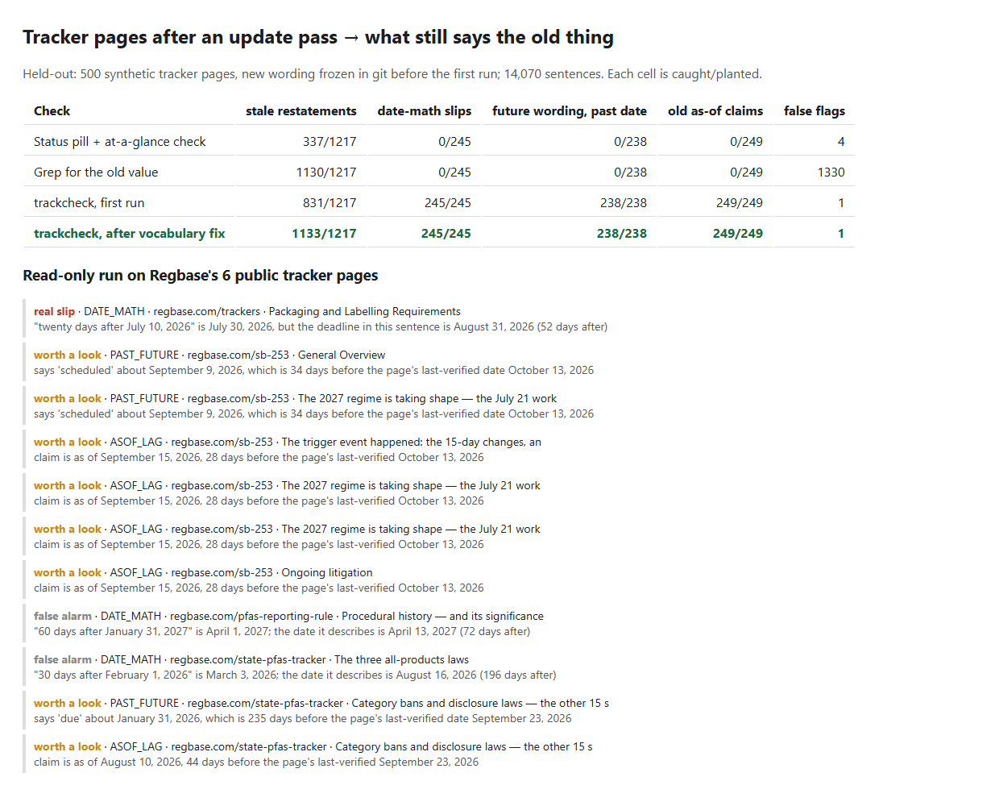

# Tracker update check: after an event, what on the page still says the old thing?

> Unofficial prototype by Kushagra Pratap Singh. Not affiliated with Regbase.

[Regbase's public trackers](https://regbase.com/trackers) restate each fact in many places: the status pill, the at-a-glance table, the overview, the body, the FAQ, the key dates and the changelog. On the [SB 253 tracker](https://regbase.com/sb-253), the first-report deadline appears all over the page. The history of that deadline ("June 30 → August 10 → November 10") also sits on the same page and must *not* change.

When OAL approved the regulation on October 12, the changelog lists what was touched: *"Updated the description, status pills, first-deadline line and status line; the first-deadline, implementing-regulation, penalties-and-fees and open-questions rows; the General Overview; …"*. That is a find-every-copy job on every event, for every tracker.

`trackcheck` takes a page plus a dated event ledger. It returns:
- the **edit list** for an incoming event, with section and sentence;
- **checks** on the page after the update pass.

History and changelog lines are left alone.



## Checks
| Kind | What it means |
|---|---|
| STALE_RESTATEMENT | A non-history sentence about a fact (deadline, comment close, stage) still states a value the ledger has superseded. This includes stage wording such as "remains proposed" after approval. |
| DATE_MATH | A stated interval doesn't match the calendar, such as "N days/weeks/months after X" or "an N-day comment period … due Y". The check is subject-aware: "the deadline arrives N days after X" is compared with the due date. Rules like "whichever is later" and "each year" are skipped. |
| PAST_FUTURE | Future or pending wording ("scheduled", "will", "due", "expected") governs a date that is before the page's last-verified date. |
| ASOF_LAG | A claim checked against a source carries its own "as of" date more than 14 days older than the page's last-verified date. |
| CONFLICT | Two current restatements of one fact disagree. Used when there is no ledger. |

Tense is decided per sentence. Sentences in the history and changelog sections count as history, and so do sentences with cues like "moved from", "originally", "had been", "→" and "no longer". History sentences are never flagged as stale.

## Results

### Held-out: 500 synthetic tracker pages (`eval/bank_heldout.py`, committed in `8f0dfb2` before the first run)
The generator ([`trackcheck/synth.py`](trackcheck/synth.py)) works like this:
- It builds a program with a deadline, a comment close date and a stage.
- One or two events arrive.
- The page restates each fact in 6 sections, and a simulated editor updates each restatement with probability 0.7. The rest are planted stale lines.
- History lines quote the old values on purpose.
- It also plants date-math slips, future wording on past dates, and old as-of claims, each with a clean twin.

The held-out bank uses new programs and new wording for everything.

| Check | stale restatements | date-math slips | future wording, past date | old as-of claims | false flags (of 14,070 sentences) |
|---|---|---|---|---|---|
| Status pill + at-a-glance check | 337/1,217 | – | – | – | 4 |
| Grep for the old value anywhere | 1,130/1,217 | – | – | – | **1,330** |
| **trackcheck, first run** (`out/heldout_first_run.json`) | **831/1,217** | **245/245** | **238/238** | **249/249** | **1** |
| trackcheck after the vocabulary fix (`out/heldout.json`) | 1,133/1,217 | 245/245 | 238/238 | 249/249 | 1 |

**Read this honestly:**
- **First run: 68% of stale lines caught.** The misses were wording the fact vocabulary didn't know: "compliance date", "have until … to submit", "comment" without an s, "awaiting final approval", and "nothing is final yet" (which was read as *final*).
- **After the first run** I widened the vocabulary in [`trackcheck/facts.py`](trackcheck/facts.py). The added lines are marked in the file. The second row is no longer a held-out number. What it shows is that the remaining work is vocabulary, which a real tracker would configure per program.
- **The grep baseline** catches nearly every stale line but also flags every history and changelog line, so it gives 1,330 false flags.
- **The 1 false flag** is a coincidence: the comment deadline equalled the superseded filing deadline.
- **The other three kinds** are planted from a few templates each, so 100% there mostly shows the arithmetic and tense rules work. The live pages below are the harder test.

The dev bank (`python evaluate.py --dev`, 300 pages, which the checker was built against) scored 681/699 stale lines with 0 false flags.

### Regbase's 6 public tracker pages, read-only (`python real_pages.py`; one GET per page, run 2026-10-17)
I built the checker partly while looking at these pages, so this is not a held-out result. It found 11 items:
- **1 real slip.** On the tracker feed, the Jul 30 line says *"comments now due August 31, 2026 — the operative deadline arrives twenty days after the July 10 announcement"*. Twenty days after July 10 is when the *notice* published (July 30). The deadline is 52 days after. The GRAS and state-additive pages state it correctly.
- **8 worth a look.**
  - Five claims are dated "as of September 15" (or "as of August 10") on pages last verified 28–44 days later.
  - In two places, "scheduled … September 9" still appears on a page verified October 13. The page itself notes it couldn't confirm the session took place.
  - One law description says "first reports due Jan 31, 2026".
  - None of these is wrong. They're the re-check list.
- **2 false alarms.** Both are DATE_MATH on long rows that pack several dates and intervals together, where the checker paired the interval with the wrong date.

Page text isn't committed. `out/real_pages.json` keeps one quoted sentence per finding.

## Run it (Python 3.10+, stdlib only)
```
python -m pytest -q tests          # 7 tests
python demo.py                     # fictional page: event -> edit list -> checks
python evaluate.py                 # held-out bank (evaluate.py --dev for dev); python real_pages.py for the live pages
```
`python report.py` rebuilds `out/report.html`.

## Limits
- Facts are linked by cue phrases plus dates. That's fast and explainable, but wording outside the vocabulary is missed: 84 of 1,217 even after the fix.
- An LLM extractor could propose the fact links, and these rules would then verify them.
- It checks the page against a ledger you give it. It doesn't read primary sources, and it doesn't decide which source wins when sources disagree.
- PAST_FUTURE and ASOF_LAG are prompts to re-check, not errors.
